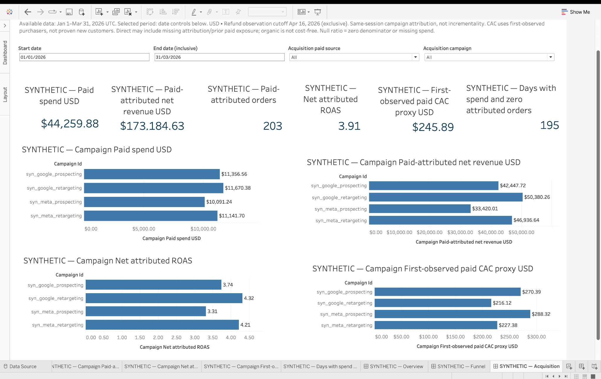
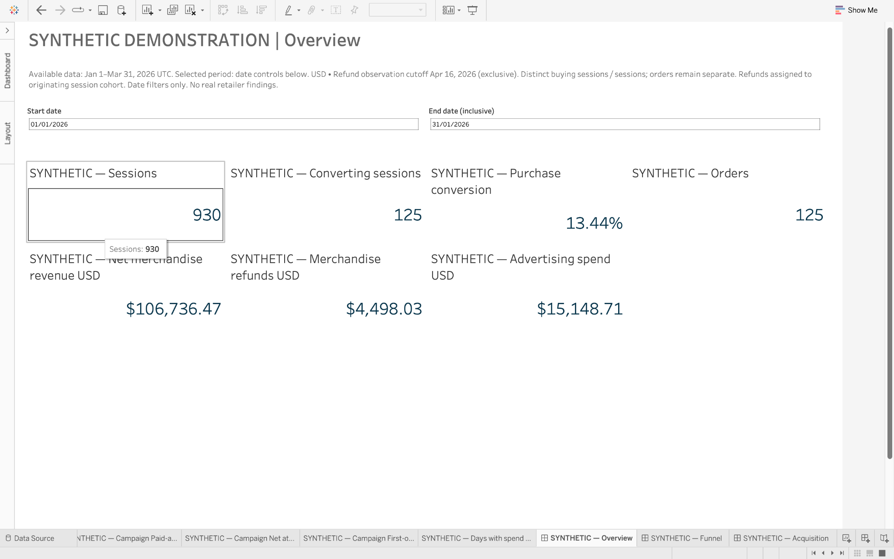
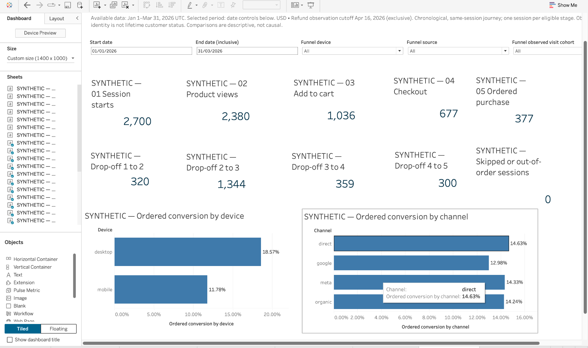

# E-commerce Growth Analytics

I created this project to investigate customer journeys, purchases, refunds and advertising performance for a fictional online mattress retailer. I wanted to understand where visits stop progressing towards a purchase and how I could check the numbers before recommending a change to the shopping experience or an advertising budget.

**This is a synthetic-data project.** I generated the records for the analysis; they do not represent real customers or a real retailer's results. No experiment was run, and no sales improvement or advertising impact is claimed.

## What I set out to understand

An online store can attract visitors without knowing why many of them leave before buying. Purchase events may also differ from order records, and refunds change the amount of revenue that remains. I approached these issues together rather than treating the funnel and advertising figures as separate stories.

My main questions were where the ordered journey loses sessions, whether conversion differs across devices and traffic sources, whether purchases and money reconcile, and which campaign results deserve further investigation. The analysis covers **January 1–March 31, 2026**, in UTC and USD, with modeled refunds observed before April 16.

The [detailed case study](docs/PORTFOLIO_CASE_STUDY.md) explains the decisions, findings and limitations. The supporting [measurement plan](docs/MEASUREMENT_PLAN.md) and [data dictionary](docs/DATA_DICTIONARY.md) define exactly what is counted.

## How I approached the work

I first defined the measures, then used Python to generate linked visitor, session, event, order, item, refund and campaign-spend tables. I used SQL to check relationships and reconcile money before analysing the journey. Separate hand-calculated examples test problems such as duplicate events, late arrivals, multiple refunds and more than one order in a session.

| Tool | How I used it |
|---|---|
| Python | Generate repeatable synthetic data, coordinate processing and run validation |
| SQLite and SQL | Build the local analysis, reconcile orders/refunds and calculate ordered funnels and acquisition measures |
| BigQuery and GoogleSQL | Compare equivalent results in a cloud warehouse; 96/96 comparisons passed on November 13, 2026 |
| Tableau Public | Build three dashboards with embedded local data; the workbook has not been published to Tableau Public |
| Git and GitHub | Preserve the source, documentation, reviewed outputs and release history |

One important modelling decision was to keep the three dashboard datasets separate. Advertising spend belongs to a campaign on a particular day; joining it to every event would repeat the same cost. I also kept orders separate from converting sessions. If a session contains two orders, it still contributes only one converting session to the conversion rate.

## Main findings

These are calculated observations from the simulation, not evidence of actual customer behaviour.

| Question | Result | What I take from it |
|---|---|---|
| How many sessions converted? | 377 of 2,700, or **13.96%**; 377 orders from 331 purchasing identities | Count sessions, orders and people separately, even when two counts happen to match |
| How did refunds affect merchandise revenue? | **$345,007.20** before refunds, less **$14,084.25**, leaving **$330,922.95** | Original merchandise revenue alone would overstate what remained after modeled refunds |
| Where was the largest funnel loss? | 2,380 product-view sessions became 1,036 cart sessions: **1,344 lost**, or **43.53% progression** | Investigate product-page progression, but check event coverage and delayed journeys before assigning a cause |
| How did devices compare? | Mobile **11.78%**; desktop **18.57%** | Compare similar source/visit cohorts before interpreting the aggregate gap as friction |
| How did paid-attributed revenue compare with spend? | **$173,184.63** net revenue assigned to paid campaigns against **$44,259.88** spend; ROAS **3.91** | The assignment rule describes performance; it does not prove the advertisements caused these purchases |

Return on ad spend (**ROAS**) divides assigned revenue by advertising spend. It is not profit. The **$245.89 first-observed paid customer acquisition cost proxy** is also deliberately qualified: the dataset cannot establish whether a purchaser is genuinely new. There are **195 campaign-days with spend and zero attributed orders**, but this is not enough evidence to call that spend wasted.

## My recommendations

Based on these results, I would investigate product-page progression first. The size of the product-view-to-cart loss makes it a useful starting question. I would validate the tracking, then look for real usability evidence about price, delivery and returns information before proposing a change.

Next, I would compare mobile and desktop within similar traffic-source and observed-visit groups. The simulated device gap is clear, but its cause is not established. Finally, I would examine attribution windows and unmatched purchases before recommending budget changes. These priorities are explained in the [case study](docs/PORTFOLIO_CASE_STUDY.md#my-recommendations) and [decision report](dashboard/DECISION_REPORT.md).

I developed the first recommendation into a [proposed experiment](docs/EXPERIMENT_PROTOCOL.md): test clearer product information using persistent visitor assignment, completed purchasing as the primary outcome, and revenue/refund/technical guardrails. **The proposal is unexecuted**, and its sample-size assumptions would need real baseline evidence before use.

## The dashboards

The workbook has three views: **Overview** for traffic and reconciled money, **Funnel** for ordered journey progression and comparisons, and **Acquisition** for campaign-day spend and attributed outcomes. Ratios use the selected totals rather than averages of daily percentages.

The images below are genuine screenshots of the accepted source layout. They retain the original interface, selection outlines and tooltips; nothing was retouched. [Screenshot provenance](dashboard/screenshots/README.md) records their origin.



*Acquisition: January–March results. Assigned revenue and ROAS do not establish causal advertising impact or profit.*

<details>
<summary>View the Overview and Funnel screenshots</summary>



*Overview: January 1–31 only, so these totals differ from the full-period figures above.*



*Funnel: January–March. Each step counts sessions that reached it in the required order.*

</details>

## How I checked the work

I checked unique keys, table relationships, chronology, duplicate handling and revenue/refund limits. Independent small examples provide expected answers, and spend and revenue reconcile with zero differences. Recorded dashboard checks include eight SQL/Hyper comparison cases, 50 expression checks and all 1,637 rows in the packaged dashboard datasets.

Actual Tableau evidence separately covers visible totals, selected filters, empty results, resets, filter isolation and reopening the relocated source workbook without reconnecting data. The final release was repackaged with the same extracts and equivalent workbook XML, with relative paths and matching CSVs restored. It passed automated package validation but did **not** receive a separate agent GUI reopen. The [acceptance record](release/ACCEPTANCE.md) makes this distinction explicit.

BigQuery verification is historical: it passed on November 13, 2026, with recorded demo-table expiration on November 19. I have not rechecked present cloud availability. The local workbook does not need those tables. AI assistance supported drafting and implementation; execution, independent fixtures and my supplied Tableau evidence were used to review the work.

## Open or reproduce the project

| Resource | Purpose |
|---|---|
| [Detailed case study](docs/PORTFOLIO_CASE_STUDY.md) | Full account of the problem, approach, findings and recommendations |
| [Final Tableau workbook](release/SYNTHETIC_Growth_REVIEW.twbx) | Download and open locally; data are embedded, with no BigQuery login needed |
| [Dashboard reproduction guide](dashboard/README.md) | Prerequisites and commands for a separate accepted-layout rebuild |
| [SQL pipeline guide](docs/SQL_PIPELINE.md) | Local processing, cutoffs, output files and independent fixture arithmetic |
| [Evidence index](release/EVIDENCE_INDEX.md) | Dated validation records and package provenance |

For the local analysis, the verified environment is Python 3.14.8 with SQLite 3.50.4 on macOS ARM64. Core analysis uses only the Python standard library:

```sh
python3.14 -m venv .venv
.venv/bin/python scripts/run_analysis.py
```

Run from the repository root. The command runs tests, creates the default baseline if absent, verifies it and writes SQLite/CSV/report outputs under ignored `data/generated/analysis/`. Optional Tableau extract generation uses separately pinned dependencies; follow the dashboard guide rather than installing them into the core environment. Rebuilds produce a separate workbook and preserve the accepted release.

## Scope and future improvements

The synthetic investigation and its documented dashboard acceptance are complete. Real GA4, Shopify, Google Ads, Meta Ads and Hotjar ingestion are not implemented. The simulation simplifies identity, pricing, refunds and attribution, and has no landing-page field. These limits restrict what I can conclude; they do not prevent another person from reproducing the completed analysis.

Reasonable next steps are independently validated real data, landing-page measurement and attribution-sensitivity work. Any live experiment would require separate evidence and approval. See the [follow-up backlog](docs/FOLLOW_UP_BACKLOG.md).

The final workbook, preceding-release backup and reviewed synthetic exports are tracked. Credentials, environments, bulk generated outputs and original exploratory workbooks remain ignored. The repository is public; Tableau remains unpublished. [Project brief](PROJECT_BRIEF.md) · [Progress](PROGRESS.md) · [Integration status](docs/INTEGRATIONS.md)
